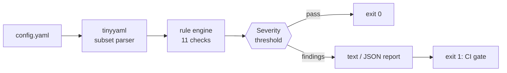

# litaudit


**Zero-dependency security auditor for LiteLLM / LLM-gateway config files.**

One command statically audits your `config.yaml` for exactly the classes of
misconfiguration that have caused real-world incidents — most recently the
**October 2026 LiteLLM supply-chain attack**, where a master key committed
to a config file in a public repo gave an attacker owner-level access to an
entire GitHub organization, release pipeline included.

litaudit catches the failure *before* the commit, where it costs nothing to
fix: hardcoded master keys, literal provider API keys,
credential-bearing database URLs, missing spend controls, wildcard model
routes, plaintext endpoints, remotely-pointed callbacks, and telemetry that is never explicitly off.

```
$ litaudit config.yaml

[FAIL] config.yaml — 10 finding(s): 3 critical, 2 high, 4 medium, 1 low

  CRITICAL LIT-001  general_settings.master_key
         master_key literal committed to config — any copy of this file grants full admin over the proxy
         fix: rotate immediately and reference os.environ/MASTER_KEY

  CRITICAL LIT-002  model_list[0].litellm_params.api_key
         provider api_key literal (model 'gpt-4o') matches OpenAI-style key
         fix: store provider keys in the environment and reference them as os.environ/PROVIDER_KEY
         ...
```

*Every finding prints the exact line of defense to fix it.*

---

## Why this exists

LLM gateways (LiteLLM being the most deployed) sit on **every provider key
you own**, impersonate your teams to GitHub, and hold your full model spend
in one config file. That config is:

- copied between environments ("just take prod's config"),
- committed to repos,
- pasted into tickets, AI chats and CI logs.

The result is a single file whose leakage equals a full infrastructure
compromise — which is precisely how the LiteLLM incident played out: the
master key was *spotted and force-pushed away* within days, but **never
revoked**, and five months later it was used to steal org-owner tokens and
ship a malicious PyPI release of the package itself.

litaudit makes the config file itself a first-class audit target.

---

## Installation

```bash
# from this repository
pip install git+https://github.com/mehulpatel23b-pixel/litaudit.git

# verify — zero dependencies will be pulled
litaudit --version        # 1.0.0
```

No dependencies. Python 3.9+ standard library only. Works in CI runners,
air-gapped boxes and scratch containers without a pip mirror.

Run straight from a checkout if you prefer:

```bash
PYTHONPATH=src python -m litaudit path/to/config.yaml
```

---

## Usage

```bash
litaudit config.yaml                                  # text report, fail on MEDIUM+
litaudit prod/*.yaml staging/*.yaml                  # multiple files
litaudit config.yaml --fail-on critical              # only CRITICAL fails the run
litaudit config.yaml --quiet                         # just the summary line
litaudit config.yaml --json > audit.json             # machine-readable (SOAR/CI glue)
```

### Exit codes (CI gate)

| code | meaning |
|------|---------|
| `0`  | no findings at or above the `--fail-on` threshold |
| `1`  | ≥1 finding at or above the threshold |
| `2`  | usage error or unparsable/unreadable file |

```yaml
# .github/workflows/gate.yml (excerpt)
- name: Gateway config audit
  run: |
    pip install git+https://github.com/mehulpatel23b-pixel/litaudit.git
    litaudit configs/prod.yaml --fail-on high
```

Any pull request that introduces a literal secret into the gateway config
fails the build — before it reaches the git history where it lives forever.

---

## Rule catalog

| rule | severity | what it catches | where it looks |
|------|----------|-----------------|----------------|
| `LIT-001` | critical | master key committed literally (live-looking, short, or placeholder) | `general_settings.master_key` |
| `LIT-002` | critical/high | provider `api_key` literals instead of `os.environ/...` | `model_list[*].litellm_params` |
| `LIT-003` | high | database URL with embedded `user:password` | `general_settings.database_url` |
| `LIT-004` | critical | plaintext provider secrets in `environment_variables` | `environment_variables.*` |
| `LIT-005` | medium | provider endpoints over plaintext `http://` | `litellm_params.api_base` |
| `LIT-006` | high/medium | no master key configured at all | `general_settings` |
| `LIT-007` | medium | wildcard model routes exposing every deployment behind one key | `model_list[*].model_name` |
| `LIT-008` | medium | zero budget/rate controls anywhere (runaway agent loop bills your cap) | whole file |
| `LIT-009` | low | usage telemetry not explicitly disabled | `litellm_settings.telemetry` |
| `LIT-010` | medium | callbacks shipping full prompts to a remote URL | `callbacks` |
| `LIT-011` | high | weak/placeholder values (`changeme`, `yourkey`, ...) in any key/secret/token field | whole file |

Secret-looking values are **masked** in all output (`sk-Ab…90`); litaudit
never prints a full credential it found.

---

## Architecture



```
litaudit/
├── src/litaudit/
│   ├── cli.py        # argument handling, exit codes, text & JSON reports
│   ├── scanner.py    # rule engine: 11 checks, severity model
│   ├── tinyyaml.py   # dependency-free YAML-subset parser
│   └── __main__.py   # python -m litaudit
├── examples/
│   ├── dangerous_config.yaml   # intentional bad patterns (all fake keys)
│   └── clean_config.yaml       # production-safe reference config
└── tests/
    ├── test_tinyyaml.py        # parser: 16 tests
    └── test_scanner.py         # rules + CLI: 23 tests
```

---

## Real-world use cases

1. **Pre-commit gate** — wire `litaudit` into CI so a config carrying a
   literal key never lands in git history (where it survives every later
   deletion).
2. **Post-incident sweep** — after any key-rotation event, run it across
   every copy of the gateway config in every repo and runbook folder to
   confirm the rotated key is truly gone.
3. **Gateway handover review** — inheriting a LiteLLM deployment? Audit the
   config before you trust one byte of it.
4. **Vendor/agent config CI** — many AI agent stacks (including agent
   harnesses and MCP gateways) ship LiteLLM-shaped configs; audit whatever
   YAML they generate before it touches a real cluster.
5. **SOC triage** — point it at configs found in tickets, screenshots
   transcriptions, or seized repos and get an instant one-screen risk grade
   in JSON.
6. **Golden-config diffing** — keep a known-good clean config, audit both,
   diff the finding sets to review ops-automated config changes.
7. **Security training** — the `examples/dangerous_config.yaml` file is a
   self-contained exercise: run the tool, fix every finding, exit 0.

---

## Honesty section

- litaudit is **static and heuristic**: it reads one config file and reasons
  about patterns. It cannot see your runtime env, database contents, or
  which keys were actually revoked. Treat it as a smoke test that makes the
  *common* failure classes impossible to miss, not a proof of security.
- `tinyyaml` implements a **subset of YAML** (nested maps, list blocks,
  scalars, inline lists, comments). Exotic anchors, flow nesting and
  multi-document streams are not supported; misparsed values are absorbed
  harmlessly rather than crashing the audit. If a file reports a parse
  error, audit it by hand.
- Secret patterns (OpenAI/Anthropic/AWS/Google/GitHub/xAI shapes) cover the
  common formats; a custom provider key it has never seen will still be
  flagged by the "literal where an env ref belongs" rules.
- LiteLLM config schema evolves; rule locations follow the documented
  stable fields (`master_key`, `database_url`, `model_list`, `litellm_settings`,
  `router_settings`, `callbacks`, `environment_variables`).

---

## Contributing

Found a config foot-gun litaudit misses? A failing fixture (fake keys only
— never real credentials, even "expired" ones) plus a rule sketch is a
perfect PR.

## License

[MIT](LICENSE)
